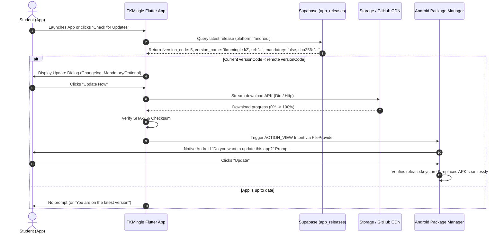
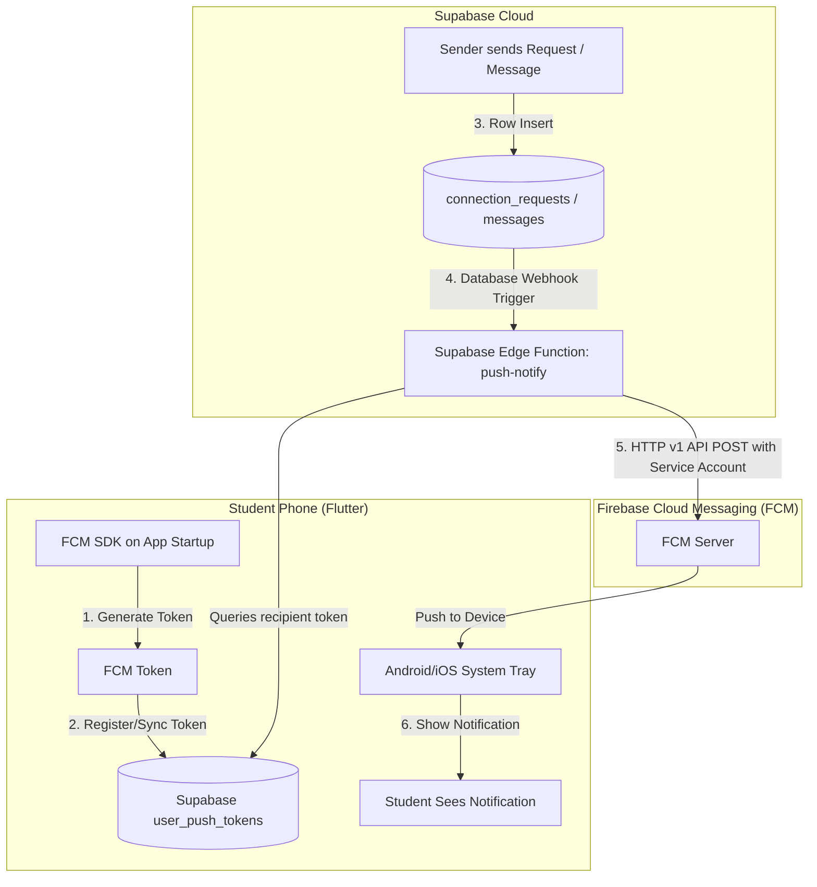

# TKMingle: Feasibility Analysis — In-App Auto-Updating & Mobile Push Notifications

This report provides a formal engineering evaluation, architectural design, security analysis, and feasibility calculation for two upcoming mobile features for **TKMingle**:
1. **In-App Auto-Updating** (Direct APK / OTA without Google Play Store dependency).
2. **Push Notifications to Mobile Phones** (FCM + Supabase Webhooks & Edge Functions).

---

## 1. Feasibility Analysis: In-App Auto-Updating System

### 1.1 Objective
Enable the TKMingle Flutter Android application to detect new versions, download update packages in the background with progress feedback, and trigger the native installation prompt directly on the user's phone, without requiring manual website downloads or Google Play Store involvement.

### 1.2 Feasibility Score
- **Android Platform Feasibility:** **95% (Highly Feasible & Standard Industry Practice)**
- **iOS Platform Feasibility:** **0% for native sideloading (Apple App Store Guideline 2.5.2 blocks downloading executable code outside App Store)**. For iOS, CodePush (via **Shorebird**) or TestFlight/App Store is mandatory.

---

### 1.3 Architecture & Data Flow



---

### 1.4 Technical Requirements & Implementation Blueprint

#### A. Database Schema (`public.app_releases`)
```sql
CREATE TABLE public.app_releases (
  id UUID PRIMARY KEY DEFAULT gen_random_uuid(),
  platform TEXT NOT NULL CHECK (platform IN ('android', 'ios')),
  version_code INTEGER NOT NULL,
  version_name TEXT NOT NULL,
  download_url TEXT NOT NULL,
  is_mandatory BOOLEAN NOT NULL DEFAULT false,
  min_supported_version_code INTEGER DEFAULT 1,
  changelog TEXT,
  sha256_checksum TEXT,
  published_at TIMESTAMPTZ DEFAULT now()
);

-- Public read access so any app instance can check for updates
ALTER TABLE public.app_releases ENABLE ROW LEVEL SECURITY;
CREATE POLICY "Allow public read on app_releases" ON public.app_releases
  FOR SELECT USING (true);
```

#### B. Android Native Configuration
1. **Manifest Permission:**
   ```xml
   <uses-permission android:name="android.permission.REQUEST_INSTALL_PACKAGES" />
   ```
2. **FileProvider Configuration (`res/xml/file_paths.xml`):**
   ```xml
   <?xml version="1.0" encoding="utf-8"?>
   <paths>
       <external-cache-path name="update_apks" path="." />
       <cache-path name="internal_update_apks" path="." />
   </paths>
   ```
3. **Manifest Provider Declaration:**
   ```xml
   <provider
       android:name="androidx.core.content.FileProvider"
       android:authorities="${applicationId}.fileprovider"
       android:exported="false"
       android:grantUriPermissions="true">
       <meta-data
           android:name="android.support.FILE_PROVIDER_PATHS"
           android:resource="@xml/file_paths" />
   </provider>
   ```

#### C. Flutter Package Selection
- **Option 1 (Recommended):** `ota_update: ^5.0.0` or lightweight custom MethodChannel (`FileProvider` + `Intent.ACTION_VIEW` with MIME `application/vnd.android.package-archive`).
- **Option 2 (Shorebird CodePush):** For instant Dart-level hot patching without generating or downloading full 50MB APKs.

---

### 1.5 Critical Constraints & Risk Assessment
1. **Keystore Integrity (CRITICAL):**
   All future APK updates **MUST** be signed with the exact same `release.keystore` (`SHA256: 79:39:4A:0E:1F:C2:7C:EA:9F:A8:DF:ED:AF:73:2F:02:20:43:CA:58:DB:D3:B3:10:68:29:66:98:66:F6:29:9C`). If an update is signed with a different key, Android will block the installation with `INSTALL_FAILED_UPDATE_INCOMPATIBLE`.
2. **Unknown Sources Permission:**
   On Android 8.0 through Android 15, Android requires the user to grant "Install unknown apps" permission to TKMingle once. The app must guide the user with a gentle prompt leading directly to `Settings.ACTION_MANAGE_UNKNOWN_APP_SOURCES`.
3. **Version Code Monotonicity:**
   `versionCode` must always be strictly increasing (e.g. `4` -> `5` -> `6`). Android Package Manager rejects installing an APK if `versionCode` is lower than or equal to the currently installed version.

---

## 2. Feasibility Analysis: Mobile Push Notifications System

### 2.1 Objective
Deliver real-time mobile push notifications to students' phones when:
1. Another student sends them a **Connection Request**.
2. A student accepts their Connection Request.
3. A student sends them a **Direct Message**.
4. An announcement is posted in a **Campus Circle** they are enrolled in.

### 2.2 Feasibility Score
- **Feasibility:** **95% (Highly Feasible, Standard Architecture)**
- **Operating Cost:** **$0.00 / Free** (FCM is 100% free with unlimited messages; Supabase Edge Functions offer 500,000 free invocations/month).

---

### 2.3 Architecture & Data Flow



---

### 2.4 Technical Requirements & Implementation Blueprint

#### A. Token Registration Schema (`public.user_push_tokens`)
```sql
CREATE TABLE public.user_push_tokens (
  id UUID PRIMARY KEY DEFAULT gen_random_uuid(),
  user_id UUID NOT NULL REFERENCES public.profiles(id) ON DELETE CASCADE,
  fcm_token TEXT NOT NULL,
  platform TEXT NOT NULL CHECK (platform IN ('android', 'ios', 'web')),
  device_name TEXT,
  created_at TIMESTAMPTZ DEFAULT now(),
  updated_at TIMESTAMPTZ DEFAULT now(),
  UNIQUE (user_id, fcm_token)
);

ALTER TABLE public.user_push_tokens ENABLE ROW LEVEL SECURITY;

CREATE POLICY "Users can manage their own push tokens"
  ON public.user_push_tokens
  FOR ALL
  USING (auth.uid() = user_id)
  WITH CHECK (auth.uid() = user_id);
```

#### B. Supabase Database Webhook & Edge Function
1. **Trigger Configuration:**
   Trigger on `INSERT` on `public.connection_requests` and `public.messages`.
2. **Edge Function Payload (`push-notify/index.ts`):**
   Calls `https://fcm.googleapis.com/v1/projects/{PROJECT_ID}/messages:send` using Google Service Account JWT.
   ```json
   {
     "message": {
       "token": "RECIPIENT_FCM_TOKEN",
       "notification": {
         "title": "New Connection Request",
         "body": "Devika S. wants to connect with you on TKMingle"
       },
       "data": {
         "click_action": "FLUTTER_NOTIFICATION_CLICK",
         "route": "/app/discover",
         "type": "connection_request",
         "sender_id": "sender_uuid"
       },
       "android": {
         "priority": "high",
         "notification": {
           "channel_id": "tkmingle_connections",
           "icon": "ic_launcher",
           "color": "#8875FF"
         }
       }
     }
   }
   ```

#### C. Mobile Client Configuration (Flutter)
- **Dependencies:** `firebase_core`, `firebase_messaging`, `flutter_local_notifications`.
- **Permissions (Android 13+ / API 33):**
   ```xml
   <uses-permission android:name="android.permission.POST_NOTIFICATIONS"/>
   ```
- **Notification Channels (Android):**
   Create explicit notification channels (`tkmingle_connections`, `tkmingle_messages`) with high importance and vibration enabled so OEM task managers (MIUI, ColorOS, OneUI) do not suppress them.

---

## 3. Feasibility Summary Table

| Evaluation Dimension | In-App Auto-Update | Mobile Push Notifications |
| :--- | :--- | :--- |
| **Technical Complexity** | Moderate (2–3 days) | Moderate (2–3 days) |
| **Platform Compatibility** | Android 8.0–15 (100%), iOS (Requires Shorebird) | Android (100%), iOS (100% via APNs) |
| **Third-Party Cost** | $0.00 (Supabase Storage / GitHub CDN) | $0.00 (FCM is Free) |
| **Security Bar** | High (Strict SHA-256 verification & Keystore matching) | High (Google Service Account OAuth2 + RLS tokens) |
| **User Experience Impact** | Extremely High (No manual APK downloading) | Extremely High (Instant connection & chat alerts) |
| **Recommendation** | **Feasible & Highly Recommended for Phase 2** | **Feasible & Highly Recommended for Phase 2** |
